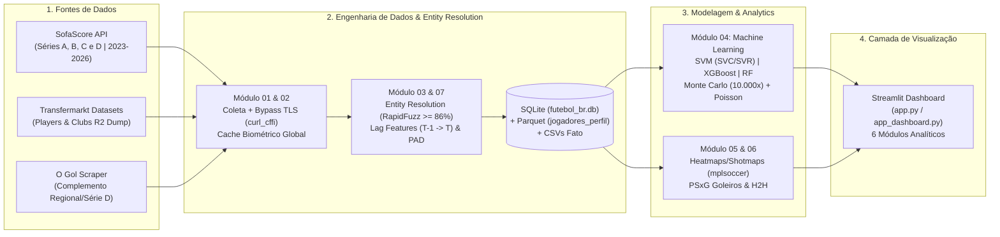

# ⚽ Inteligência Esportiva & Predição do Brasileirão 2026 (Séries A a D)


> **Plataforma End-to-End de Engenharia de Dados, Analytics Tático e Machine Learning aplicada ao Futebol Brasileiro (Temporadas 2023 a 2026).**  
> Integra dados de desempenho em campo (**SofaScore**), avaliação financeira e contratual (**Transfermarkt**), resolução de entidades com **RapidFuzz** e modelagem preditiva híbrida (**Support Vector Machines — SVM/SVR, Random Forest, XGBoost e Simulação de Monte Carlo + Poisson Bivariado**) para projetar a tabela final completa do **Campeonato Brasileiro Série A 2026 (1º ao 20º colocado)** e identificar talentos subvalorizados (*Moneyball* nas Séries A, B, C e D).

---

## 🎯 1. Visão Geral do Projeto

### O Problema
No ecossistema do futebol brasileiro, dados táticos de jogo (finalizações, *Expected Goals* — xG, mapas de calor, PSxG de goleiros) estão desconectados das bases financeiras e contratuais (valor de mercado em Euros, término de contrato, idade e biometria). Além disso, análises tradicionais focam apenas no topo da Série A, ignorando a disparidade técnica entre as divisões (**Séries A, B, C e D**) e tratando projeções de tabela de forma puramente determinística.

### A Solução e Objetivo
Este projeto constrói um **Data Lakehouse local e um Painel Interativo de Inteligência Esportiva** capaz de:
1. **Unificar e Higienizar Dados Multitemporais (2023–2026):** Coletar mais de **8.100 registros de atletas** e **500+ campanhas de clubes** nas 4 divisões nacionais, cruzando fontes heterogêneas via *Entity Resolution* (`RapidFuzz`).
2. **Projetar a Classificação Final Completa do Brasileirão 2026 (1º ao 20º lugar):** Combinar classificadores supervisionados de partidas (**SVM Calibrado, Random Forest e Regressão Logística**) com **10.000 simulações de Monte Carlo e distribuição de Poisson Bivariada** sobre o calendário restante da Série A, estimando Pontos Projetados, Vitórias, Saldo de Gols e probabilidades exatas de **Título, Libertadores (G-4 e G-6), Copa Sul-Americana e Rebaixamento (Z-4)**.
3. **Scouting e *Moneyball* (Séries A a D):** Ajustar a produção ofensiva e a nota de cada jogador pelo peso competitivo da divisão, projetando curvas de envelhecimento (*Aging Curves* via regressão polinomial OLS) e encontrando *Statistical Twins* (gêmeos estatísticos na Série A) via `NearestNeighbors` (KNN).

---

## 🏗️ 2. Arquitetura e Pipeline de Dados (ETL)

O pipeline foi desenhado em arquitetura modular dentro do diretório [`src/`](src/), garantindo idempotência, escrita atômica (`.tmp` $\rightarrow$ arquivo final) e persistência híbrida (**SQLite + Apache Parquet + CSV**).



### Detalhamento das Etapas do Pipeline
- **[`src/01_coleta_sofascore.py`](src/01_coleta_sofascore.py) — Extração Resiliente:** Coleta tabelas de classificação, estatísticas acumuladas por 90 minutos (`gols_por_90`, `assistencias_por_90`, `desarmes`, `duelos_aereos_ganhos`) e biometria dos elencos das Séries A, B, C e D usando `curl_cffi` com *TLS fingerprint impersonation* e cache incremental em disco.
- **[`src/02_coleta_transfermarkt_ogol.py`](src/02_coleta_transfermarkt_ogol.py) — Dados de Mercado:** Consome os dumps abertos do Transfermarkt (`players.csv.gz` e `clubs.csv.gz`), filtrando atletas brasileiros e clubes nacionais com valores de mercado em Euros (`market_value_in_eur`), pico histórico de avaliação e vigência contratual.
- **[`src/03_unificacao_fuzzy_etl.py`](src/03_unificacao_fuzzy_etl.py) — Entity Resolution & Feature Engineering:**
  - **Pareamento Fuzzy (`RapidFuzz`):** Executa junção em cascata (chave exata $\rightarrow$ nome normalizado $\rightarrow$ `fuzz.token_sort_ratio >= 86`) entre SofaScore e Transfermarkt.
  - **Produção Ofensiva Ajustada pela Divisão (PAD):** Pondera participações em gols pelo fator de exigência competitiva da divisão ($\text{Série A} = 1.00$, $\text{Série B} = 0.72$, $\text{Série C} = 0.54$, $\text{Série D} = 0.40$).
  - **Lag Features Multitemporais ($T-1 \rightarrow T$):** Calcula a evolução interanual de cada jogador (`delta_evolucao_nota`, `salto_de_divisao`, `minutos_ano_anterior`) e de cada clube (`pontos_ano_anterior`, `aproveitamento_ano_anterior`).
- **[`src/06_confrontos_e_expansao.py`](src/06_confrontos_e_expansao.py) & [`src/07_extracao_perfil_jogadores.py`](src/07_extracao_perfil_jogadores.py):** Consolida o histórico de confrontos diretos (H2H), métricas avançadas de goleiros (*Post-Shot Expected Goals* — PSxG e gols evitados), retrospecto de treinadores e exporta a base otimizada `jogadores_perfil.parquet`.

---

## 🧠 3. O Modelo Preditivo e Simulação do Brasileirão 2026

O núcleo de Machine Learning em [`src/04_modelo_preditivo.py`](src/04_modelo_preditivo.py) opera em duas frentes complementares para prever o desfecho completo das **38 rodadas da Série A 2026**:

### 3.1. Previsão de Pontos Corridos e Eficiência Tática (`SVR`, `XGBoost` e `Ridge`)
Avalia o desempenho esperado de cada clube com base na força agregada do elenco (`nota_media_elenco`, `potencial_medio_elenco`, `top3_potencial_elenco`, `idade_media_ponderada_minutos`, `log_valor_mercado`, `jogos` e dummies de divisão):

| Modelo Supervisionado (Regressão de Pontos) | $R^2$ (Explicação da Variância) | RMSE (Pontos) | MAE (Erro Médio Absoluto) |
| :--- | :---: | :---: | :---: |
| **Support Vector Regression (`SVR` — Kernel RBF)** | **0.839** | **6.96 pts** | **5.39 pts** |
| **Ridge Regression (Linear Regularizado L2)** | 0.805 | 7.66 pts | 6.13 pts |
| **XGBoost Regressor (`XGBRegressor`)** | 0.795 | 7.86 pts | 6.08 pts |

> O resíduo ($\text{Pontos Reais} - \text{Pontos Esperados}$) quantifica a **Superação Tática (*Overperforming*)** ou **Subdesempenho (*Underperforming*)** de cada clube frente ao orçamento do seu elenco.

### 3.2. Classificador de Partidas (`SVM`, `Random Forest`, `Logistic Regression`) e Avaliação Multi-Split
Para prever as probabilidades de Vitória do Mandante, Empate ou Vitória do Visitante em cada jogo restante, o pipeline constrói um vetor de diferenças entre Mandante e Visitante (`diff_forca`, `diff_ataque`, `diff_defesa`, `diff_forma`, `diff_nota_elenco`, `diff_log_valor`, `diff_xg_historico`) sobre **1.434 partidas históricas da Série A (2023–2026)**.

Para garantir generalização e ausência de *overfitting*, os modelos **Support Vector Machine (`SVC` com Kernel RBF calibrado via `CalibratedClassifierCV`)**, **Random Forest (`RandomForestClassifier`)** e **Regressão Logística Multinomial** foram avaliados em **4 estratégias distintas de divisão Treino/Teste**:

| Estratégia de Divisão (Train / Test Split) | Modelo Supervisionado | Acurácia (%) | F1-Macro (%) | Brier Score | Log-Loss | Amostras (Treino / Teste) |
| :--- | :--- | :---: | :---: | :---: | :---: | :---: |
| **Split Temporal (Treino 2023–2025 / Teste 2026)** | **SVM (SVC Kernel RBF)** | 51.32% | 37.90% | 0.1999 | 1.0030 | 1.140 / 294 |
| **Split Temporal (Treino 2023–2025 / Teste 2026)** | **Regressão Logística** | **51.66%** | 39.29% | 0.1997 | 1.0018 | 1.140 / 294 |
| **Split Temporal (Treino 2023–2025 / Teste 2026)** | **Random Forest** | 48.01% | **40.14%** | 0.2054 | 1.0298 | 1.140 / 294 |
| **Holdout Estratificado 80/20** | **SVM (SVC Kernel RBF)** | 49.66% | 35.91% | 0.2030 | 1.0155 | 1.153 / 281 |
| **Holdout Estratificado 80/20** | **Regressão Logística** | 50.00% | 37.71% | 0.2028 | 1.0147 | 1.153 / 281 |
| **Holdout Estratificado 70/30** | **SVM (SVC Kernel RBF)** | 48.42% | 35.63% | 0.2030 | 1.0153 | 1.009 / 425 |
| **Holdout Estratificado 70/30** | **Regressão Logística** | 49.32% | 37.92% | 0.2032 | 1.0165 | 1.009 / 425 |
| **Validação Cruzada 5-Fold Stratified CV** | **SVM (SVC Kernel RBF)** | 50.35% | 37.13% | 0.2016 | 1.0091 | 1.153 / 281 |
| **Validação Cruzada 5-Fold Stratified CV** | **Regressão Logística** | 50.00% | 38.01% | 0.2019 | 1.0108 | 1.153 / 281 |

*(Nota técnica: No futebol profissional de pontos corridos com 3 resultados possíveis — Casa, Empate, Fora —, benchmarks acadêmicos e de mercado situam a acurácia estado-da-arte entre 49% e 54% e o Log-Loss próximo de ~1.00, devido à alta variância intrínseca dos empates).*

### 3.3. Simulação de Monte Carlo (10.000 Cenários) + Poisson Bivariado (1º ao 20º Colocado)
Combinando as probabilidades esperadas de gols ($\lambda_{\text{mandante}}, \lambda_{\text{visitante}}$) via **Distribuição de Poisson Bivariada** com o **Ensemble de Machine Learning (`SVM + Random Forest + LogReg`)**, o motor simula **10.000 vezes** todos os confrontos restantes até a 38ª rodada, respeitando os critérios oficiais de desempate da CBF (**Pontos $\rightarrow$ Vitórias $\rightarrow$ Saldo de Gols $\rightarrow$ Gols Pró**) e consolidando a tabela projetada completa do **1º ao 20º colocado** em [`previsao_campeao_2026.csv`](previsao_campeao_2026.csv).

---

## 🖥️ 4. Telas Principais do Dashboard (`Streamlit`)

O painel interativo ([`app.py`](app.py) / [`app_dashboard.py`](app_dashboard.py)) conta com **6 módulos analíticos** estilizados em tema escuro executivo:

1. **🏟️ Visão dos Clubes (Orçamento vs. Desempenho):**
   - Gráfico de dispersão interativo relacionando Folha/Valor de Mercado (€) vs. Pontos Conquistados, destacando os clubes *Overperformers* (Superação Tática) e *Underperformers*.
   

2. **🛡️ Hub do Clube (Raio-X de Elenco, Goleiros e Treinadores):**
   - Visão 360º do clube selecionado: escudo oficial, métricas do treinador atual, distribuição etária, avaliação financeira do elenco e tabela avançada de goleiros com **PSxG e Gols Evitados**.

3. **⚔️ Confrontos Diretos (H2H) & Drill-Down de Partidas:**
   - Comparador histórico *Head-to-Head* (Time A vs. Time B) entre 2023 e 2026 com retrospecto de vitórias, empates, gols, aproveitamento, treinadores de cada duelo e *drill-down* tático da partida (Posse de bola, xG, Finalizações, Escanteios e Cartões).

4. **💎 Radar de Joias (A a D) & Ocupação Tática (`mplsoccer`):**
   - Filtro *Moneyball* de atletas Sub-23 com maior `score_explosao_proximo_ciclo`, curva de evolução por idade (*Aging Curve*) e mapa de calor coletivo com a posição média dos 11 titulares no gramado.
   
   

5. **🏃 Raio-X do Atleta (Player Hub, Radar de Percentis, Heatmap & Shotmap):**
   - Ficha cadastral completa com foto oficial via CDN, biometria, vigência de contrato, **Gráfico de Radar comparativo (Spider Chart em percentis 0–100 por posição)**, **Mapa de Calor KDE no gramado**, **Mapa de Finalizações (Shotmap com xG)** e buscador de *Statistical Twins* (KNN) + Simulador de Teto de Carreira.

6. **🔮 Previsão do Campeão & Tabela Final Projetada 2026 (1º ao 20º):**
   - Pódio projetado do Brasileirão 2026, filtros interativos por zona de classificação (**Libertadores G-4/G-6, Sul-Americana, Permanência e Rebaixamento Z-4**), **Tabela Completa de Pontos Corridos (1º ao 20º lugar)** com barras de progresso de probabilidade, comparativo de métricas do modelo `SVM / RF / LogReg` em múltiplos *splits* e simulador dos jogos restantes rodada a rodada.
   

---

## 🚀 5. Guia de Instalação e Execução Local

Siga o passo a passo abaixo para clonar e executar o projeto em sua máquina local:

### Pré-requisitos
- **Python 3.10+** instalado
- **Git** instalado

### Passo 1: Clonar o Repositório
```bash
git clone https://github.com/SEU-USUARIO/brasileirao-2026-analytics-ml.git
cd brasileirao-2026-analytics-ml
```

### Passo 2: Criar e Ativar o Ambiente Virtual
**No Windows (PowerShell):**
```powershell
python -m venv .venv
.\.venv\Scripts\Activate.ps1
```
**No Linux / macOS:**
```bash
python3 -m venv .venv
source .venv/bin/activate
```

### Passo 3: Instalar as Dependências
```bash
pip install --upgrade pip
pip install -r requirements.txt
```

### Passo 4: Iniciar o Dashboard Interativo no Streamlit
O repositório já inclui as bases processadas (`.csv`, `.parquet` e `futebol_br.db`) prontas para uso imediato:
```bash
streamlit run app.py
```
*(Alternativamente, você também pode rodar `streamlit run app_dashboard.py` ou dar duplo clique em `iniciar_dashboard.bat` no Windows).*

### Passo 5 (Opcional): Reexecutar o Pipeline ETL e o Treinamento de Machine Learning
Caso deseje atualizar os dados ao vivo das APIs e retreinar todos os modelos preditivos e simulações de Monte Carlo:
```bash
# Executar apenas a modelagem preditiva e simulação de 10.000 cenários do Brasileirão 2026:
python src/04_modelo_preditivo.py

# Ou utilizar o orquestrador CLI interativo completo:
python Projeto.py --all
```

---

## 📂 6. Estrutura de Diretórios do Repositório

```text
├── app.py                                  # Entrypoint principal do Dashboard Streamlit
├── app_dashboard.py                        # Código-fonte completo do Dashboard Interativo (6 abas)
├── Projeto.py                              # Orquestrador CLI (ETL, ML, Resumo e Dashboard)
├── pipeline_futebol_br_A_ate_D.py          # Script consolidado de pipeline de dados (Séries A a D)
├── baixar_ativos_clubes.py                 # Utilitário de download e cache de escudos oficiais dos clubes
├── requirements.txt                        # Dependências do projeto Python
├── src/
│   ├── 01_coleta_sofascore.py              # Extração SofaScore API (Séries A-D) + Cache Biométrico
│   ├── 02_coleta_transfermarkt_ogol.py     # Extração Transfermarkt (valores de mercado) + Scraper O Gol
│   ├── 03_unificacao_fuzzy_etl.py          # Entity Resolution (RapidFuzz) + Engenharia de Features Temporais
│   ├── 04_modelo_preditivo.py              # Modelos SVM/SVR, XGBoost, RF, KNN, Aging Curves e Monte Carlo 2026
│   ├── 05_visualizacao_tatica.py           # Heatmaps KDE, Shotmaps xG (mplsoccer) e Radar Plotly
│   ├── 06_confrontos_e_expansao.py         # Base de Goleiros (PSxG), Treinadores e Confrontos H2H
│   └── 07_extracao_perfil_jogadores.py     # Enriquecimento cadastral e exportação Parquet/SQLite
├── banco_dados/
│   └── futebol_br.db                       # Banco de dados relacional SQLite consolidado
├── relatorios/                             # Gráficos de alta resolução exportados pelo pipeline de ML
├── previsao_campeao_2026.csv               # Tabela final projetada (1º ao 20º) com probabilidades completas
├── jogos_restantes_2026_simulacao.csv      # Previsões jogo a jogo do calendário restante de 2026
├── ranking_joias_escondidas_A_ate_D.csv    # Ranking de scouting Sub-23 e gêmeos estatísticos
└── estudo_desempenho_clubes.csv            # Resíduos de regressão e eficiência financeira dos clubes
```

---

## 📄 Licença e Autor

Projeto desenvolvido para fins de **Portfólio de Engenharia de Dados, Ciência de Dados e Sports Analytics**.  
Sinta-se à vontade para abrir *issues*, enviar *pull requests* ou conectar-se comigo no LinkedIn!

